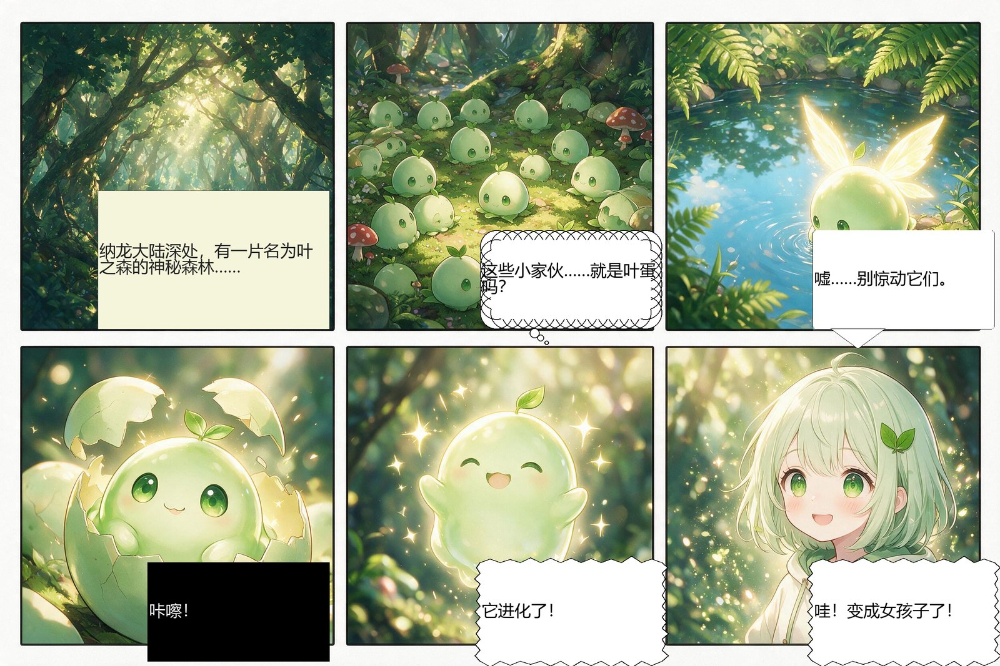
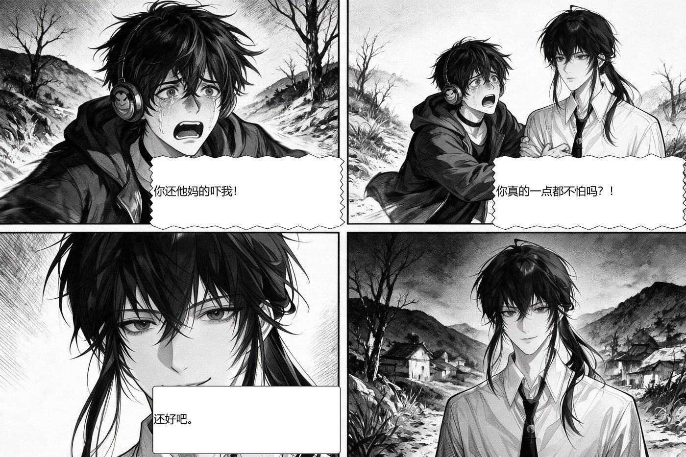

<div align="center">

# ✨ 小说⇄漫画 双向转换器 ✨

**把小说变成漫画 · 把漫画变回小说 · 一杯咖啡的时间**

让 AI 帮你把 3000-8000 字的小说自动拆分成日式黑白漫画分镜、生成画面、画上对白气泡——**不用学画画，也能出整页漫画**。

[](https://www.python.org/)
[](https://flask.palletsprojects.com/)
[](LICENSE)
[](https://github.com/yourname/text2comic)

[✨ 在线体验](#-三步出整页漫画) · [📸 看效果](#-看效果) · [🚀 快速开始](#-快速开始) · [💬 交流反馈](#-交流反馈)

---

</div>

## 🎬 这是什么？

写小说一时爽，但想做漫画？找人画太贵，AI 工具又零散——

**小说⇄漫画转换器** 是一个开箱即用的 Web 应用，把整条流水线打通：

> 📖 **小说输入** → 🤖 **AI 自动分镜** → 🎨 **AI 画整页** → 💬 **自动加气泡对白** → 📚 **导出 / 永久保存**

**而且支持反向** —— 上传漫画图片，AI 帮你"看图写话"，变回小说文本。

想试试？[看效果](#-看效果) 👀

---

## ⚡ 三步出整页漫画

```bash
git clone https://github.com/yourname/text2comic.git
cd text2comic
pip install -r requirements.txt
python app.py
```

浏览器打开 `http://localhost:2778`，搞定。

> 🎯 **不需要 GPU**，全靠云端 API；不需要美术基础，全靠 AI 分镜；不需要写一行代码。

---

## 📸 看效果

### 🎭 自动识别角色 + 保持人设一致
AI 先读完整本小说，提取每个角色，自动生成人设参考图。后续每页分镜都带人设参考，**同一个角色翻 100 页也不会变脸**。

<p align="center">
  
</p>

### 📖 一键智能分镜
不用手动规划镜位、画分镜草稿。AI 自动把小说拆成 2-8 格的整页结构，标注好**视角、构图、情绪、景别、光照**——专业漫画师的镜头术语 AI 都会用。

<p align="center">
  
</p>

### 🎨 整页黑白漫画一键出图
不是单格凑，是 **整页** 生成。AI 自适应 2x2 / 2x3 / 3x3 网格，自动配上网格线、画面风格统一。

<p align="center">
  
</p>

### 💬 8 种对白气泡，零乱码
喊叫 / 耳语 / 心理 / 旁白 / 拟声词... 8 种气泡形状，AI 根据语气自动选型。**图像 API 不画中文**（会乱码），所有对白由后端用系统中文字体（微软雅黑 / 黑体 / 宋体）精准渲染——**100% 不出现方框字**。

<p align="center">
  
</p>

### 🔄 反向：漫画 → 小说
上传漫画图片，AI 看图写话，按页拆分还原成小说文本。**支持批量**，把整本漫画扫描版丢进去也能拆。

<p align="center">
  
</p>

---

## 🎯 解决什么痛点？

| 痛点 | 解法 |
|------|------|
| 想做漫画但不会画 | 全程 AI 出图，你只负责提供小说 |
| AI 画漫画中文乱码 | 后端用系统字体精准渲染，零乱码 |
| 角色画着画着就变了 | 角色人设参考图 + 上一页整页自动参考 |
| 工具零散要拼装多个 App | 一个 Web 应用搞定整条流水线 |
| 长篇小说来不及画 | 一次投 8000 字，AI 自动拆成 N 页 |
| 漫画扫了想二次创作 | AI 反向把漫画变回小说 |

---

## ✨ 核心亮点

- 🎯 **零美术门槛** —— 粘贴小说 → 出整页漫画，无需任何绘画基础
- 🎨 **风格统一** —— 同一本漫画从头到尾角色不跑形、画风不漂移
- 💬 **零乱码** —— 后端 PIL 本地渲染中文，告别方框字
- 🖱️ **拖拽式气泡编辑** —— 觉得气泡位置不对？拖一下就行
- 🌐 **Web 端使用** —— 浏览器即开即用，无需安装客户端
- 📱 **支持打包成 APP** —— 内置 Capacitor 配置，可一键生成 Android 安装包
- 📚 **多用户系统** —— 注册账号即可永久保存作品
- 🔌 **OpenAI 协议兼容** —— 用 GPT-4 / Claude / 国产大模型都可以
- 🔁 **双向转换** —— 小说→漫画 + 漫画→小说，一个应用搞定两种工作流
- ⚡ **实时进度** —— WebSocket 推送，再也不用盯着假进度条

---

## 💡 适合谁用？

- ✍️ **网文作者** —— 让读者先看漫画预告版，引流回小说
- 🎨 **独立漫画人** —— 用 AI 加速草稿阶段，专心打磨故事
- 🎓 **学生 / 教师** —— 把课文 / 名著做成漫画版，更生动
- 🎮 **剧本作者** —— 用漫画格式快速验证分镜可行性
- 📖 **小说 AI 爱好者** —— 玩 CosyVoice / RVC / TTS 的同好，可联动做"漫画 → 配音"全流程
- 🎁 **送礼 / 纪念** —— 把朋友的网文 / 自己的日记做成漫画册

---

## 🚀 快速开始

### 环境

- Python 3.8+
- 现代浏览器（Chrome / Edge / Firefox / Safari）
- 一个能调用的文本 LLM API + 图像生成 API（OpenAI 协议兼容即可）

### 启动

```bash
git clone https://github.com/yourname/text2comic.git
cd text2comic
pip install -r requirements.txt
python app.py
```

打开浏览器访问 `http://localhost:2778` → 看到宣传页 → 点 **开始使用** → 用默认管理员账号登录（首次启动密码会打在控制台）。

### 第一次配置 API

进入 **API 配置** Tab，选个预设填上 Key 即可：

| 预设 | 推荐模型 |
|------|----------|
| 🌋 **火山引擎 v3**（默认推荐） | 文本 `minimax-m3` + 图像 `doubao-seedream-3.0` |
| 🟢 **OpenAI** | GPT-4 / DALL·E 3 / 或者任何兼容接口 |

### 然后呢？

把小说粘进文本框（3000-8000 字最佳），点 **开始智能分镜**，等 30 秒看 AI 怎么拆你的故事。满意就一键生成整页漫画，几十秒一页——一杯咖啡的时间一本漫画就出来了。

---

## 🎬 看到这儿了，要不要给个 Star？

如果这个项目对你有帮助：

⭐ **点个 Star** 是对小初最大的鼓励！也方便你以后回来找到它。

🐛 **遇到问题** 可以提 Issue，小初会尽量回复。

🔧 **想贡献代码** 欢迎 PR，新功能 / Bug 修复 / 文档改进都很欢迎。

分享给朋友也很棒 ✨

---

## 💬 交流反馈

- 🐛 **Bug 报告**：GitHub Issues
- 💡 **新功能建议**：GitHub Discussions
- 💬 **想聊天 / 问问题**：提 Issue 选 Discussion 类型

---

## 📜 许可证

[MIT License](LICENSE) — 自由使用、修改、商用，记得保留原作者信息 ✨

---

## 🙏 致谢

- 感谢所有开源库的贡献者
- 感谢火山引擎、OpenAI 等 API 提供商
- 感谢所有测试用户的反馈，让这个项目变得更好

---

<div align="center">

**如果这个小工具让你少熬了几个夜，记得回来点个 ⭐ 喵~**

Made with ♥ by 漫画爱好者 & AI

</div>